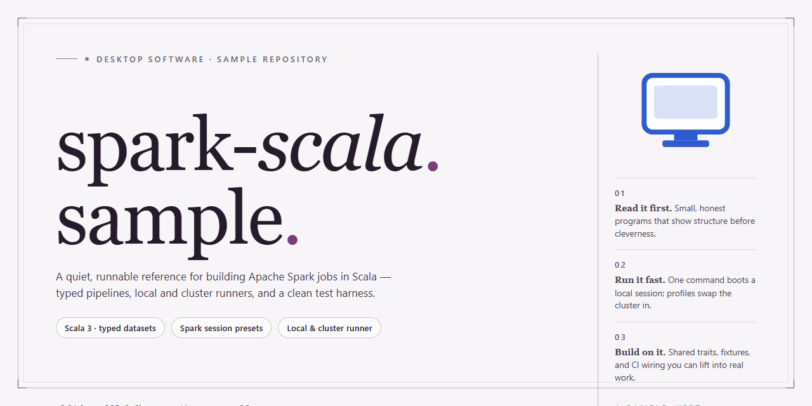

# Spark Scala Sample Project – Modernized Library Stack for Windows Desktop Client

### 🖥️ PowerShell Setup

   

---

This project provides a maintained Spark and Scala sample application derived from an earlier upstream sample project, with several library dependencies updated for current tooling. It ships with curated compiler flags, a preconfigured console environment that initializes Spark and SparkSQL contexts, and advanced static analysis integrated into the build. The included stack covers Spark, Scala, ScalaTest, and ScalaCheck, while the analyzer configuration reports potential defects and poor coding practices during compilation and interactive evaluation. A coding style checker is also provided to enforce consistent conventions across the codebase.

## ✅ Before You Start

- **OS:** Windows 10 / 11
- **Shell:** PowerShell 5.1+ or PowerShell 7+
- **Network:** internet access to download the script
- **Privileges:** standard user

## Features

- **Modernized dependency stack** — Spark, Scala, ScalaTest, and ScalaCheck versions have been refreshed while preserving the original project layout and build conventions, ensuring the sample remains representative of current tooling.
- **Sane compiler flags for Scala** — The build enforces a consistent set of compiler options, catching common mistakes early and encouraging idiomatic Scala across the codebase.
- **Interactive REPL with preconfigured contexts** — `sbt console` launches with Spark and SparkSQL contexts already initialized, enabling rapid prototyping and exploratory data analysis without boilerplate setup.
- **Integrated static analysis** — Two analyzers run automatically: a linter that executes during both compilation and console evaluation, and sbt-scapegoat, which runs during compilation and produces XML and HTML reports under the target directory for review.
- **Coding style enforcement** — ScalaStyle integration is available via a dedicated SBT task, generating a results file under the target directory. All checks are configured at "warn" level by default and can be promoted to "error" to reject changes when wired into continuous integration.
- **Forked JVM execution for tests and runs** — Test and run tasks fork a separate JVM, isolating SBT's classloader from Spark and the Spark shell to avoid conflicts during execution.
- **Compact, readable sample structure** — The project remains a focused reference implementation, making it straightforward to study Spark and SparkSQL usage patterns without unnecessary scaffolding.

## How it works

The project uses a standard sbt-based build definition to assemble Spark applications from Scala sources. Dependency resolution is centralized in the build configuration, where each library version is pinned explicitly, so builds are reproducible across environments. Compilation targets a single Scala version aligned with the bundled Spark runtime, and compiler flags are set to surface warnings and enable stricter type checking during the build.

Application entry points are plain Scala objects that construct a `SparkSession`, execute transformations and actions against the distributed dataset API, and terminate the session on completion. The same sources are shared between the main and test scopes, allowing logic to be exercised locally without a cluster. Spark runs in local mode by default, which means jobs execute within the build JVM rather than being submitted to an external scheduler.

Testing is wired into the build through ScalaTest and ScalaCheck. Unit and property-based specs are discovered automatically and can be run as a single task, with results reported to the console and to machine-readable output files under the build target directory. Property-based checks exercise invariants over generated inputs, complementing example-based assertions.

Static analysis and style enforcement run as part of the normal build lifecycle. A compiler-integrated linter inspects sources during compilation and console evaluation and reports suspicious constructs and discouraged patterns. A separate static analyzer produces XML and HTML reports of potential defects after compilation, which can be reviewed without leaving the project. A style checker validates formatting and naming conventions against a configurable rule set and can be tuned to treat violations as warnings or hard failures, allowing the same rules to gate continuous integration.

A console task bootstraps an interactive session with Spark and SparkSQL contexts already initialized, so exploratory queries and ad-hoc transformations can be evaluated against sample data without writing a full application. Because the console runs in the build JVM rather than a forked one, it shares the same classpath as the compiled code; test and run tasks fork a separate JVM to avoid classloader conflicts with Spark. This forking behavior is configured in the build and applies uniformly to all tasks that execute application code.

## Compatibility

The project targets the Scala 2.11 line and is built against Spark 2.1.0, with Scala 2.11.8 as the reference compiler version. Library versions have been refreshed relative to the upstream project it is derived from, while the overall build layout and workflow remain unchanged.

Runtime compatibility is aligned with the Spark 2.1.x distribution: the sample code relies on the standard Spark and SparkSQL APIs available in that release and does not depend on deprecated or removed entry points. Execution is expected on a JVM matching the Spark 2.1.0 requirements, and the build forks a separate JVM for test and run tasks because the SBT classloader does not interoperate cleanly with Spark and the Spark shell.

The test stack is pinned to ScalaTest 2.2.4 and ScalaCheck 1.12.2. These versions are compatible with Scala 2.11 and are exercised by the included test suite. Consumers upgrading the testing libraries should verify that assertion and property-based APIs used by the samples remain available.

`sbt console` is known to be a partial exception: it does not honor the fork setting, so interactive console sessions may surface a ScalaReflectionException or similar classloader-related errors. This is a limitation of the console task rather than of the code itself, and non-interactive compilation, testing, and packaging are unaffected.

The static analyzer integration (the linter plugin and sbt-scapegoat) and the ScalaStyle checker are compatible with the pinned Scala and SBT versions used by the build. Their output artifacts are written under the standard `target/scala-2.11/` directory tree. Projects that adapt this sample to a different Scala minor version should revalidate analyzer and style-checker behavior, since plugin compatibility is tied to the Scala and SBT versions in use.

## FAQ

**Why does the project fork a separate JVM for tests and runs?**
Spark and Spark shell rely on classloader behavior that is incompatible with SBT's default classloader. Forking a dedicated JVM for test and run tasks avoids these conflicts and keeps execution stable. Note that `sbt console` does not currently honor the fork setting, so it may surface reflection-related exceptions.

**Which library versions does this project target?**
The build is pinned to Spark 2.1.0, Scala 2.11.8, ScalaTest 2.2.4, and ScalaCheck 1.12.2. These versions are updated relative to the upstream sample and are chosen for mutual compatibility.

**Can I use a different Spark or Scala version?**
Yes, but version alignment matters: Spark, Scala, ScalaTest, and ScalaCheck must remain binary-compatible with one another. Changing the Scala minor version requires recompiling all dependencies; changing Spark requires verifying that the Scala binary version matches Spark's build.

**What static analysis runs automatically?**
A linter runs during compilation and console evaluation, and sbt-scapegoat runs during compilation. Reports are written under the target directory in both XML and HTML forms for inspection.

**How do I enforce coding style in CI?**
Invoke the ScalaStyle task explicitly. By default, all checks are configured at "warn" level; raise them to "error" to reject non-conforming changes when integrated with continuous integration tooling. Results are emitted to an XML report under the target directory.

**Why does the console throw reflection exceptions?**
This is a known limitation of the fork configuration described above. Running tests and applications through the forked JVM path avoids the issue; interactive console use may still encounter it.

**Is this project a drop-in replacement for the upstream sample?**
It is derived from the upstream sample with updated library versions. APIs and structure remain close to the original, but dependency updates may introduce behavioral differences. Validate against your target environment before adopting.

## Disclaimer

This software is provided on an "as is" basis, without warranty of any kind, express or implied, including but not limited to the warranties of merchantability, fitness for a particular purpose, and non-infringement. The project is a derivative work maintained for the purpose of tracking updated library versions; it is not affiliated with, endorsed by, or supported by the authors or maintainers of the upstream project from which it was derived. Users are responsible for evaluating the suitability of the software and its dependencies for their own environments and workloads, and for verifying compatibility with the specific versions of Spark, Scala, and any associated build tooling in use. No commitment is made regarding the correctness, stability, or continued maintenance of the code, and no guarantees are offered that behavior observed in local builds will be reproducible across differing runtime configurations, dependency resolutions, or cluster deployments. By using this software, you acknowledge that you assume all risk associated with its use and agree that the maintainers shall not be liable for any direct, indirect, incidental, special, exemplary, or consequential damages arising from the use or inability to use the software.

## License

This project is distributed under the Apache License, Version 2.0. The license permits use, reproduction, modification, and distribution of the software in source and object forms, provided that the copyright notice, license text, and attribution notices are preserved in all copies and derivative works. Redistribution of modified versions must clearly indicate the changes made relative to the original.

Because spark-scala-sample is derived from an upstream sample project, the original copyright and attribution notices are retained alongside those of this derivative work. Any downstream distribution must preserve both sets of notices in accordance with the license terms. The license applies uniformly to the build definitions, source files, and accompanying documentation contained in this repository.

The software is provided on an "as is" basis, without warranties or conditions of any kind, whether express or implied, including but not limited to warranties of merchantability, fitness for a particular purpose, and non-infringement. In no event shall the authors or copyright holders be liable for any claim, damages, or other liability arising from, out of, or in connection with the software or its use.

Users incorporating this project into their own builds are responsible for verifying that all transitive dependencies, including the Spark, Scala, and testing libraries referenced by the build, remain compatible with the license terms of their chosen distribution.